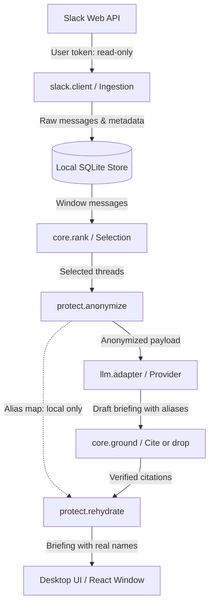

# Data flow

Version 0, 2026-10-11. Outlines data progression from Slack ingestion to on-screen presentation.

## Step-by-step pipeline

1. **Ingest:**
   - Authenticates with Slack using an internal user token (`xoxp-`) stored in Windows Credential Manager.
   - Fetches channels and conversation history for the selected date window using `conversations.history` and `conversations.replies`.
   - Persists raw messages, channel names, and user profiles into local SQLite.
2. **Select and rank:**
   - Deterministic scoring identifies relevant threads: @mentions of user, direct messages, participated threads, questions, and team discussions.
   - Caps total token payload to fit within context budget.
3. **Protect (pseudonymization):**
   - Scans selected messages against user/channel directory and secret detectors.
   - Replaces names, emails, channels, and sensitive tokens with stable aliases (`Person_01`, `Channel_02`, `You`).
   - Keeps the alias mapping in local memory / local run store.
4. **Model synthesis:**
   - Sends only the pseudonymized payload to the chosen LLM provider (local Ollama or OpenAI-compatible endpoint).
   - Receives structured briefing JSON adhering to schema v1.
5. **Grounding (cite-or-drop):**
   - Validates every citation against stored SQLite message records.
   - Unverified assertions without backing message IDs are discarded.
6. **Rehydrate and render:**
   - Replaces synthetic aliases with real colleague names.
   - Passes the final document to the desktop window for rendering.

## Data storage and retention

- **Slack token:** stored in OS keyring (`keyring`), never on disk or in SQLite.
- **SQLite database:** stored in `%LOCALAPPDATA%\slack-rewind\slack_rewind.db`. Holds message cache and briefing history for one user.
- **Alias maps:** transient per run; never exported or transmitted over network.
- **Wipe:** single "Disconnect" action purges the database file and keyring token.

